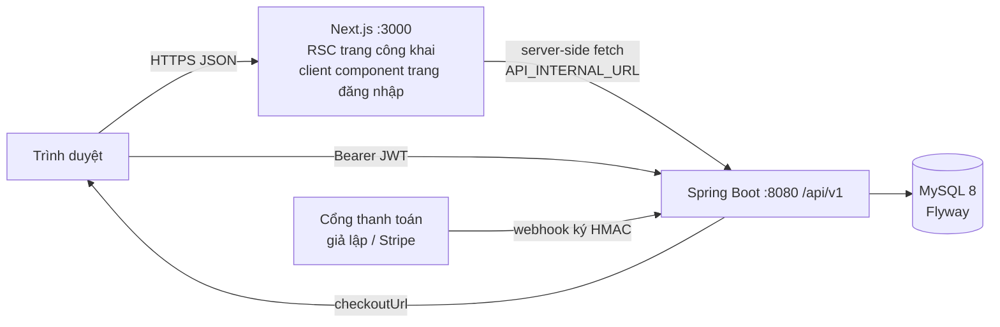

# Kiến trúc

## Backend — 4 lớp theo module (giống Architecture Design v1.0 của intern)
| Lớp | Nội dung | Ví dụ |
|---|---|---|
| presentation | Controller, request record có Bean Validation, `ApiResponse`, `GlobalExceptionHandler`, `DtoMapper` | `BookingController` |
| application | Service điều phối, `@Transactional`, port `PaymentGateway`, job | `BookingService`, `BookingExpiryJob` |
| domain | Entity JPA + quy tắc nghiệp vụ trong method, enum có bảng chuyển trạng thái | `TourDeparture.reserveSeats`, `BookingStatus.MACHINE` |
| infrastructure | Spring Data repo (có `@Lock`), Security/JWT, cấu hình, adapter cổng thanh toán, seed | `JpaTourDepartureRepository.findByIdForUpdate` |

Ranh giới: controller không gọi repository; domain không phụ thuộc Spring MVC; cổng thanh toán chỉ đi qua `PaymentGateway`.

## Frontend — Next.js App Router (giống Frontend Structure của intern)
`src/app/(public)`, `(auth)`, `(customer)`, `manager/`, `operator/`, `admin/` · `src/features/<feature>` · `src/components/{layout,shared,ui}` · `src/lib/{api,auth,config,utils}`. Trang công khai render phía máy chủ (SEO); trang cần đăng nhập là client component, token trong localStorage, api client tự refresh khi 401.

## Luồng quan trọng
1. **Đặt tour**: `BookingService.create` khoá dòng đợt → `reserveSeats` → tạo booking PENDING + bill → thông báo.
2. **Thanh toán**: `POST /bookings/{id}/payment` → `checkoutUrl` → cổng → webhook → `PaymentService.apply` khoá booking rồi payment → PAID + CONFIRMED.
3. **Hết hạn**: `BookingExpiryJob` mỗi 30 giây, mỗi booking một giao dịch.
4. **Kết thúc tour**: HDV `finish` → booking CONFIRMED → COMPLETED → mời đánh giá.
