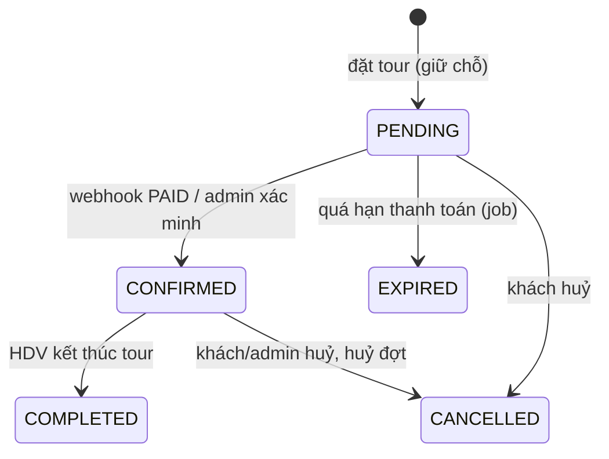

# State machine

Bảng chuyển trạng thái nằm trong chính enum (`MACHINE`); entity gọi `assertTransition` trước khi đổi. Chuyển sai → 409 `INVALID_TRANSITION`.

Đợt khởi hành: `OPEN → IN_PROGRESS → COMPLETED`, `OPEN → CANCELLED`. Bắt đầu tour làm các booking PENDING của đợt hết hạn.
Thanh toán: `PENDING → PAID | FAILED | CANCELLED`, `PAID → REFUNDED`. Không có đường từ PAID về FAILED (SRS 9.5).
